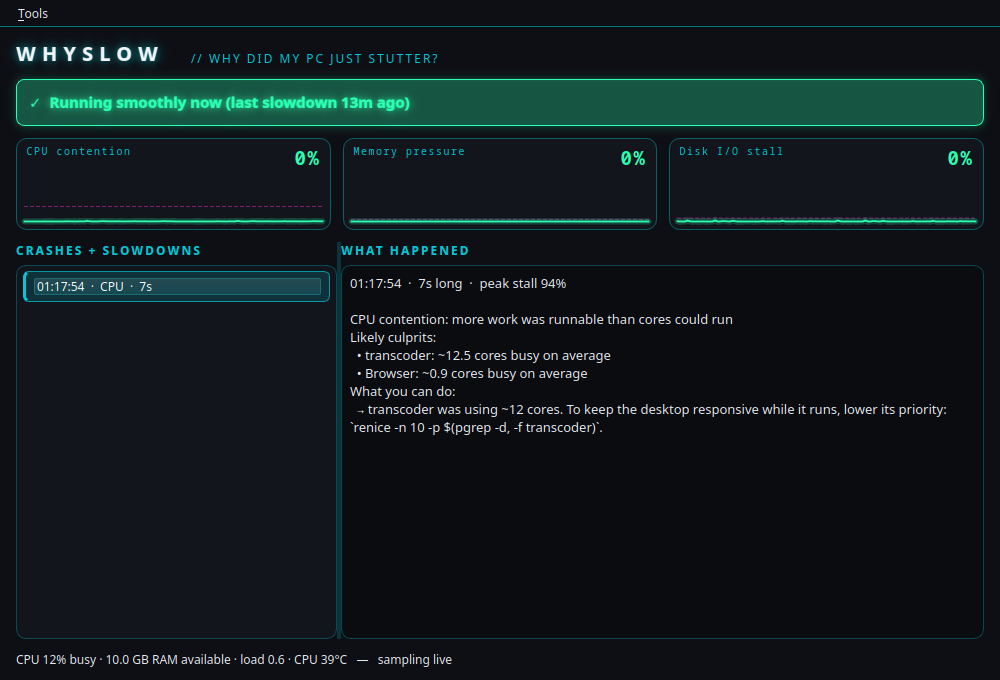

<div align="center">


<br>

<a href="https://github.com/metalmike17/whyslow/actions/workflows/test.yml"></a>
<a href="https://github.com/metalmike17/whyslow/releases/latest"></a>


<br><br>

**[⬇️ Download](https://github.com/metalmike17/whyslow/releases/latest)** &nbsp;·&nbsp; **[🚀 Install](#install)** &nbsp;·&nbsp; **[🔍 Features](#how-it-works)**

<br>



</div>


Explains, in plain English, why your Linux box just stuttered.

```
$ whyslow
#1  00:16:22  (17s, 3s ago, peak stall 11%)
    Page-in stall: programs were waiting for memory-mapped data to load from a
    saturated disk (RAM is not exhausted: 3.6 GB still available)
    Likely culprits:
      • faugus-launcher: 5515 major page faults, now using 6.2 GB
    ⚠ disk sdf was 100% busy (saturated)
```

## How it works
- `whyslow daemon` samples once a second (~2% of one core): kernel PSI stall
  percentages, per-app CPU / disk / page-fault / RSS (grouped by systemd cgroup),
  per-disk busy%, CPU clocks + temperature, swap and reclaim counters, GPU load/temperature/throttling (NVIDIA, AMD and Intel).
- `whyslow` finds stall episodes in recent history, classifies them
  (I/O, real RAM shortage, page-in from slow disk, CPU contention) and names culprits.
- No root, no eBPF, no dependencies beyond Python 3.11+ (PySide6 for the window).

## Install
Pick your distro. Recording is **opt-in**: after installing, run `whyslow enable` (starts the background sampler as a
systemd *user* service and a tray icon at login; `whyslow disable` undoes it, no root needed either way).

| Distro | How |
|---|---|
| Fedora / Nobara / RHEL-family | `packaging/make-tarball.sh && rpmbuild -ba packaging/rpm/whyslow.spec`, then `sudo dnf install ~/rpmbuild/RPMS/noarch/whyslow-*.rpm` |
| Arch / Manjaro / EndeavourOS | `cd packaging/aur && makepkg -si` (the PKGBUILD downloads the tagged release) |
| Debian / Ubuntu / Mint / Pop!_OS | `packaging/deb/build.sh && sudo apt install ./whyslow_*_all.deb` |
| Any distro, no install | Download the **AppImage** from Releases: `chmod +x WhySlow-*.AppImage && ./WhySlow-*.AppImage` (add `report`, `boot`, `hardware`… to use it as the command line). Bundles Python and Qt |
| Anything else | `sudo packaging/install.sh` (or `--prefix ~/.local`), uninstall with `--uninstall` |

Needs Python 3.11+. The command-line features need nothing else; the window needs **PySide6** (Fedora `python3-pyside6`,
Arch `pyside6`, Debian 13 / Ubuntu 26.04 `python3-pyside6.qtwidgets`). Debian 12 and Ubuntu 24.04 do not package PySide6:
use `pip install --user PySide6` there.

Tested by installing the built packages in clean containers: Fedora 44, Arch, Debian 12 and 13, Ubuntu 24.04 and 26.04.

## Use
    python3 -m whyslow                 # diagnose last 2 minutes (samples live 8s if no daemon)
    python3 -m whyslow -w 600 -n 5     # last 10 minutes, top 5 episodes
    python3 -m whyslow --json
    python3 -m whyslow gui             # live window + tray icon (needs PySide6)
    python3 -m whyslow daemon          # background sampler
    python3 -m whyslow unit > ~/.config/systemd/user/whyslow.service
    systemctl --user enable --now whyslow

## Black box: "why did my system just freeze?"
When the daemon starts and the previous run did not end with a clean-shutdown marker, it writes a
report (`~/.local/state/whyslow/incidents/`) and the GUI notifies you.

    python3 -m whyslow postmortem        # explain the last unexpected shutdown

- Tells a **whole-system** death (freeze, reset, power loss, OOM thrash) from the **sampler** merely dying.
- Searches the kernel journal around the last sample for OOM kills, GPU hangs (NVIDIA Xid / amdgpu / i915 / xe),
  overheating, kernel lockups, machine-check errors and disk errors.
- Honest about uncertainty: if everything looked normal until the last sample it says so
  ("power loss, manual reset, or a silent lockup") with *low* confidence rather than guessing.
- Needs the daemon running at the time of the crash, and read access to the journal
  (member of `wheel`, `adm` or `systemd-journal`); otherwise it says the journal was not checked.
- Cost: ~2.6 KB/s written with an fsync every 5 s (about 225 MB/day on the log).

## Known offenders: "what is this process, and can I stop it?"
Culprits that match the community database (`whyslow/data/offenders.toml`) get a plain-English
explanation, whether it is safe to stop, and a fix:

      • baloo_file: 40 MB/s disk I/O; has files on sdf
          ↳ Baloo (KDE file indexer): KDE's search indexer. (safe to pause or stop)

    python3 -m whyslow whatis baloo_file   # database entry + live biography (package, unit, disks)
    python3 -m whyslow whatis 12345        # by pid

- Kernel thread names are decoded: `kworker/u64:11+flush-8:80` becomes "kernel writeback to sdf".
- Names the kernel truncates to 15 characters (`fossilize_repla`) still match.
- **Contributing:** add an entry to `offenders.toml` (fields are documented at the top of the file).
  Only list commands you have verified; `python3 -m unittest discover -s tests` validates the schema
  and checks that ordinary programs (firefox, python3, bash...) are never flagged.

## Game stutter: "why did my game hitch?"
Record frame times with MangoHud (`whyslow stutter --how`), then:

    python3 -m whyslow stutter             # newest MangoHud log found
    python3 -m whyslow stutter FILE.csv    # or a specific one (also: GUI → Tools menu)

Each hitch (a frame ≥25 ms and ≥2.5× that second's median) is explained with what the *system* was doing at
that moment, from the daemon's recording (last ~2 hours):

- **disk** — the game's own tasks waited on I/O *and* a saturated disk holds its files (names the disk);
- **memory**, **a background program took the CPU** (names it), **thermal/power throttling**, **GPU-bound**;
- **by elimination** — if the system was calm the verdict says so, with *low* confidence ("probably shader
  compilation / game-internal"). whyslow never invents a system cause it cannot see.

Under the hood: per-app kernel pressure (PSI of each app's own cgroup) separates **victims** (whose tasks
were stalled) from **culprits** (who used the resource). Game detection is heuristic (Steam library paths and
Wine/Proton `.exe` command lines); native non-Steam games are not recognised.

## Hardware gotchas: "is something about my machine making it slow?"
    python3 -m whyslow hardware        # also: GUI → Tools menu

Read-only checks (no root) for problems no software setting shows you: a USB SSD on a USB 2 port, NVMe on
fewer PCIe lanes, SATA SSD stepped down to 3 Gbps, no TRIM, CPU stuck in a power-saving mode, swap on a
hard disk, NTFS through slow ntfs-3g, Steam library or system on a spinning disk, hot NVMe, and big write
buffers that freeze the desktop during slow USB copies. Each finding states its evidence and confidence, and
anything that cannot be proven (e.g. a USB 3 drive on a USB 2 port reports itself as USB 2) is marked as such.
Fixes are printed, never run. Findings about a disk are also added to slowdown reports that involve it.

## Laptop battery: "what is draining my battery?"
    python3 -m whyslow battery         # also: GUI → Tools menu

Uses the battery's own watt readings, recorded every second while unplugged, and compares them with what was
running: "while Firefox was busy the battery drew 6 W more than when it wasn't". It is a measured difference,
not per-process power modelling, so it is labelled a correlation. Also notes an awake discrete GPU, high screen
brightness and a worn battery, and estimates remaining time. Mouse/keyboard batteries are ignored.

## Slow boot: "why did my computer take so long to start?"
    python3 -m whyslow boot            # also: GUI → Tools menu

Breaks the boot into firmware, boot menu, kernel, initrd and services, and finds the services that actually delayed
the desktop (the critical chain), rather than everything `systemd-analyze blame` lists: most of those run in parallel
and cost nothing. It separates hardware waits (a drive that appeared late) from slow services, names known boot-time
offenders with fixes, and says plainly when most of the time is firmware, which software can't change. The daemon
remembers each boot, so "slow" is judged against your machine's own history.

## Shareable report: "help, my PC is slow" without leaking yourself
    python3 -m whyslow report [--strict] [--skip hardware,boot] [-o report.md]    # also: GUI → Tools menu

Makes one paste-ready Markdown report (system facts, recent slowdowns, crashes, hardware check, boot, battery) for a forum
post or bug report. **Nothing is uploaded**: it only prints or saves text, and the GUI shows a preview with Copy/Save.
Username, real name, hostname, home path, drive labels, UUIDs, serials, MAC/IP addresses and emails are removed, and
the report is refused (fail closed) if any of your own identifiers survive. `--strict` also masks program names that
are not well-known. It is automatic redaction, not a guarantee: skim it before posting.

## Test
    python3 -m unittest discover -s tests

## Known gaps
- GPU: NVIDIA is verified on real hardware. **AMD (amdgpu) and Intel (i915/xe) support was written from the kernel
  documentation and is tested only against simulated sysfs trees**: reports from real cards are very welcome.
  AMD thermal throttling is inferred from the temperature nearing the card's critical limit; Intel utilisation is
  derived from RC6 residency (no root-only counters), and Intel shared memory is not reported.
- Some helper processes outside an app cgroup keep generic names (e.g. "Browser").
- Culprits are correlational (who was busy during the stall), not causal; eBPF
  (per-process block-I/O latency, off-CPU time) would sharpen this.
